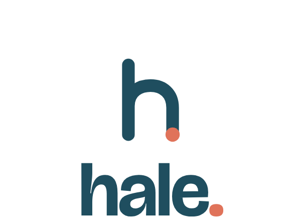
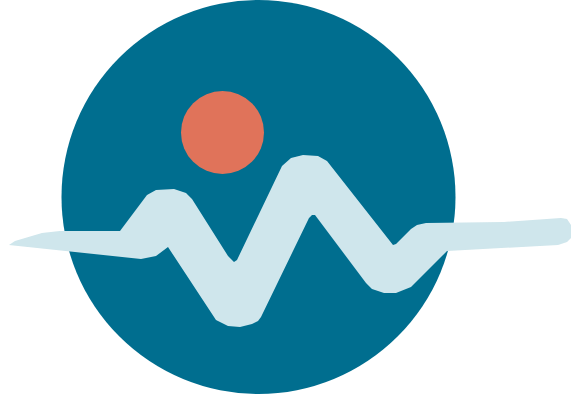
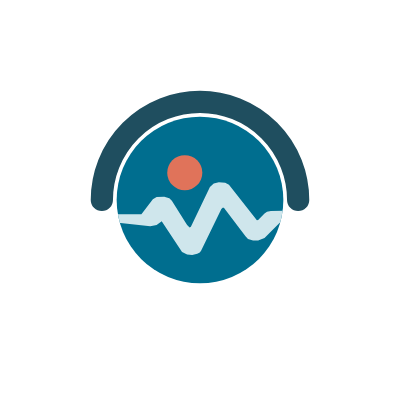

  <picture>
    <source media="(prefers-color-scheme: dark)" srcset="hale-lockup-dark.png">
    
  </picture>

  <strong>Free, offline health apps for Android.</strong> 
  Hale MTÜ is the Estonian non-profit association behind OpenVitals, OpenWatch and OpenBridge:
  no accounts, no ads, no analytics, no cloud. Your health data stays on your phone.

  <a href="https://hale.ngo">hale.ngo</a> ·
  <a href="https://openvitals.health">OpenVitals</a> ·
  <a href="https://docs.openvitals.health">Documentation</a> ·
  <a href="https://blog.openvitals.health">Blog</a> ·
  <a href="https://openvitals.zulipchat.com/">Community chat</a>

---

> Health data should be useful without becoming someone else's dataset.

## The apps

<table>
  <tr>
    <td width="120" align="center"></td>
    <td><strong><a href="https://github.com/Hale-MTU/android-app">OpenVitals</a></strong> is the dashboard: it reads your Health Connect records and turns them into a daily view with a detail screen for each metric, imports the files you already have, records activities and workouts, logs the numbers only you know, computes insights on the phone, and builds a report your doctor can hold. The app declares no internet permission. 
    <a href="https://play.google.com/store/apps/details?id=tech.mmarca.openvitals">Google Play</a> · <a href="https://f-droid.org/en/packages/tech.mmarca.openvitals/">F-Droid</a> · <a href="https://github.com/Hale-MTU/android-app/releases">GitHub releases</a></td>
  </tr>
  <tr>
    <td width="120" align="center"></td>
    <td><strong><a href="https://github.com/Hale-MTU/OpenWatch">OpenWatch</a></strong> is the devices: a Wear OS watch app and a phone app that pair Garmin and Wear OS watches and a Xiaomi scale over Bluetooth, copy what they record into Health Connect, and manage them. No internet permission either; everything travels between the device and the phone. 
    <a href="https://play.google.com/store/apps/details?id=tech.mmarca.openwatch">Google Play</a> · <a href="https://github.com/Hale-MTU/OpenWatch/releases">GitHub releases</a></td>
  </tr>
  <tr>
    <td width="120" align="center"></td>
    <td><strong><a href="https://github.com/Hale-MTU/OpenBridge">OpenBridge</a></strong> is the way out: a separate, optional app that reads the data OpenVitals chooses to share and can pass it on to online services. It is the only app in the family with internet access, and it is early stage; no service is connected yet.</td>
  </tr>
</table>

## Privacy by design

|  |  |
|---|---|
| 🚫 **No internet permission** | OpenVitals and OpenWatch do not request network access. |
| 👤 **No account** | There is no cloud account and no server. |
| 📊 **No ads or analytics** | The apps contain no tracking SDKs. |
| 🩺 **Health Connect is the source of truth** | Your data stays in Android's own health store. |

Read the [privacy page](https://docs.openvitals.health/app/privacy) for details.

## Repositories

| Repository | What it is |
|---|---|
| [**android-app**](https://github.com/Hale-MTU/android-app) | The OpenVitals Android app (Kotlin, Jetpack Compose, Health Connect). |
| [**OpenWatch**](https://github.com/Hale-MTU/OpenWatch) | The OpenWatch phone and Wear OS apps and the link between them. |
| [**OpenBridge**](https://github.com/Hale-MTU/OpenBridge) | The OpenBridge app. Early stage. |
| [**docs**](https://github.com/Hale-MTU/docs) | Source for [docs.openvitals.health](https://docs.openvitals.health). |
| [**landing-page**](https://github.com/Hale-MTU/landing-page) | Source for [openvitals.health](https://openvitals.health), in 14 languages. |
| [**blog**](https://github.com/Hale-MTU/blog) | Source for [blog.openvitals.health](https://blog.openvitals.health). |
| [**design-system**](https://github.com/Hale-MTU/design-system) | Material 3 design tokens, components and UI kits. |
| [**finances**](https://github.com/Hale-MTU/finances) | The association's finances, in the open. |

All projects are free software under the **AGPL-3.0-or-later** license.

## Get involved

- 🐛 **Report a bug or request a feature:** [OpenVitals](https://github.com/Hale-MTU/android-app/issues) · [OpenWatch](https://github.com/Hale-MTU/OpenWatch/issues) · [docs and website](https://github.com/Hale-MTU/docs/issues)
- 🌍 **Translate:** [Codeberg Translate](https://translate.codeberg.org/projects/openvitals/mobile-app/)
- 🛠️ **Contribute code:** [build instructions](https://docs.openvitals.health/developers/build) · [contributing guide](https://docs.openvitals.health/developers/contributing)
- 💬 **Chat:** [Zulip](https://openvitals.zulipchat.com/)
- ❤️ **Support the project:** 

## About Hale

Hale is the old word for healthy, as in "hale and hearty". Hale MTÜ (*mittetulundusühing*, a non-profit association registered in Tallinn, Estonia) publishes the apps; the MTU in this organisation's name is that legal form. Contact: hello@hale.ngo.
